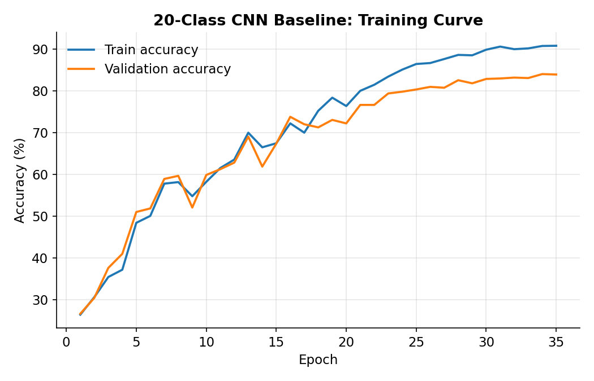
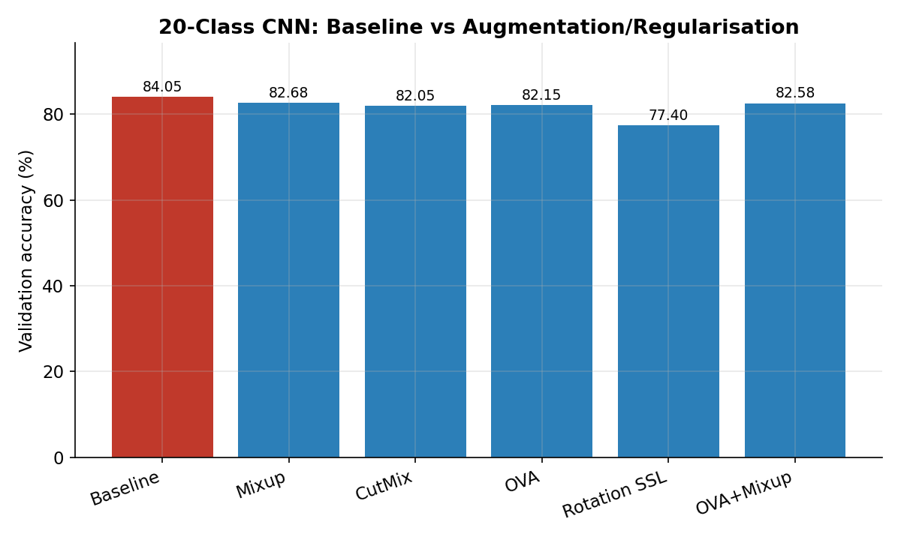
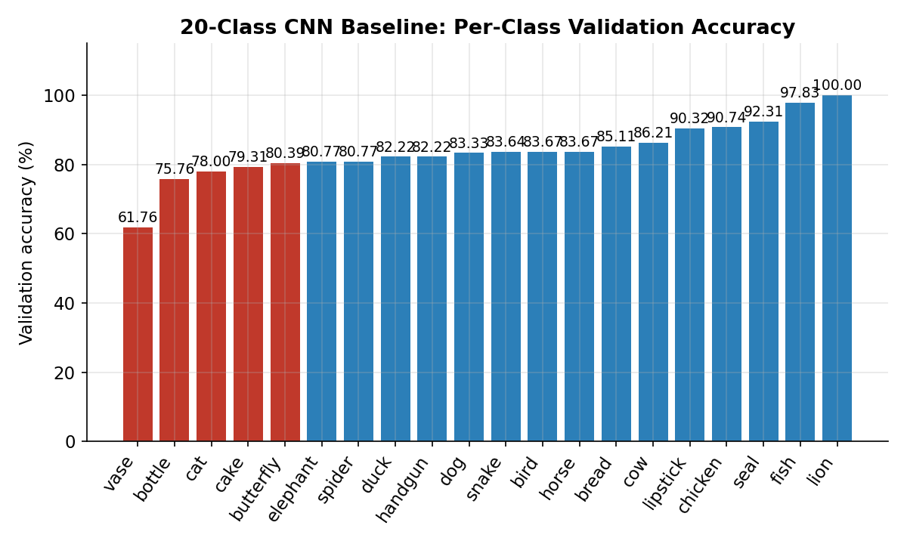

# Image Classification with CNNs

A from-scratch CNN image classifier on a 20-class image dataset, systematically compared against five augmentation/regularisation techniques and an ensemble, plus a separate pretrained-backbone fine-tune for a Kaggle-style competition on the same image domain.

## Dataset

A 20-class labelled image dataset (animals, household objects, etc.) provided for the unit, with a fixed train/validation split used throughout both notebooks.

## Approach

**`01_cnn_baseline_and_regularisation.ipynb`** trains a CNN from scratch, then trains one variant per technique (Mixup, CutMix, a one-vs-all loss, a rotation self-supervised auxiliary task, and a combined OVA+Mixup variant) under matched settings, then ensembles the top-3 models by validation accuracy and inspects per-class accuracy.

**`02_convnext_finetune_kaggle.ipynb`** fine-tunes a pretrained ConvNeXt-V2 Tiny backbone (`timm`) on the same image domain for a Kaggle-style competition, using test-time augmentation and a model-soup ensembling pipeline across several augmentation variants.

## Results

| Method | Validation accuracy | Source |
|---|---|---|
| Baseline CNN | **84.05%** | `01_cnn_baseline_and_regularisation.ipynb` |
| Mixup | 82.68% | same notebook |
| CutMix | 82.05% | same notebook |
| One-vs-all (OVA) loss | 82.15% | same notebook |
| Rotation self-supervision (λ=0.15) | 77.40% | same notebook |
| OVA + light Mixup | 82.58% | same notebook |
| 3-model ensemble (Baseline + Mixup + OVA+Mixup) | 83.95% | same notebook |
| ConvNeXt-V2 Tiny fine-tune (greedy soup + 4-view TTA) | 83.65% | `02_convnext_finetune_kaggle.ipynb` |

Full numbers, cell-level citations, and the complete per-class accuracy table are in [`../../docs/RESULTS.md`](../../docs/RESULTS.md).

## Key findings

- The plain baseline CNN beat every augmentation/regularisation variant tried, and even beat a 3-model ensemble of the strongest variants (84.05% vs. 83.95%). None of Mixup, CutMix, the OVA loss, or rotation self-supervision improved on it in this setup.
- The hardest classes by a clear margin were `vase` (61.76%) and `bottle` (75.76%) — both well below the next-hardest class (`cat`, 78.00%).
- The ConvNeXt-V2 fine-tune (83.65%) landed close to, but still below, the from-scratch baseline CNN (84.05%) on validation accuracy for the same image domain, despite using a much larger pretrained backbone and an ensembling pipeline — though the two numbers come from different notebooks/splits and aren't a strictly controlled comparison.

## Limitations

- All results are from a single training run with a single seed — no repeated-seed variance estimates exist.
- The augmentation/regularisation comparison and the ensemble are useful as a controlled study on this specific dataset and training budget; the conclusion ("augmentation didn't help here") shouldn't be generalised to other datasets or longer training schedules.
- The Kaggle notebook's own "individual val scores" block (logged before ensembling) reports numbers inconsistent with its final ensembling results — only the post-ensembling greedy-soup number (83.65%) is reported here; see `RESULTS.md` for the flagged discrepancy.
- No Kaggle public/private leaderboard score was ever recorded (the competition's test labels are withheld) — the 83.65% figure is a local validation metric, not a leaderboard score.

## What I'd do next

- Re-run the augmentation comparison with multiple seeds to check whether the baseline's edge is reliable or within run-to-run noise.
- Investigate why `vase` and `bottle` are so much harder than the rest of the classes (likely visual similarity to other classes, or fewer/noisier training examples).
- Reconcile the Kaggle notebook's inconsistent validation-score logging before trusting its intermediate numbers.

## Environment

Python, PyTorch 2.11, `timm`, trained on Apple MPS (Apple Silicon GPU).

---
*Built as part of Monash University FIT5215 Deep Learning (2026).*
