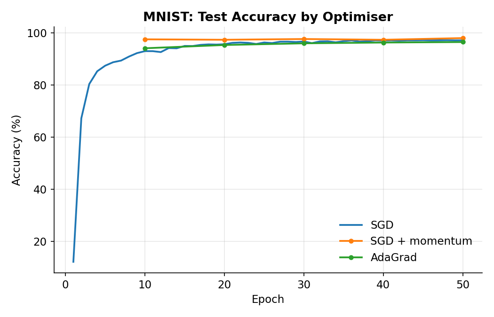
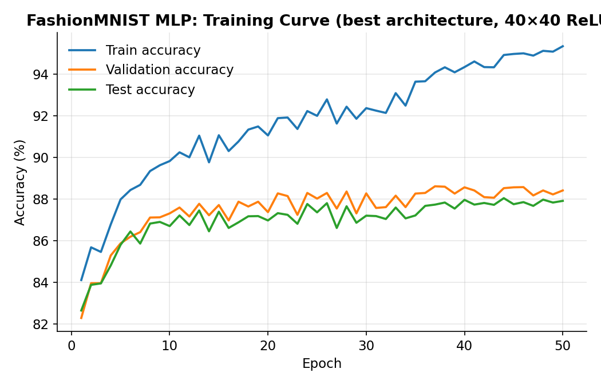

# Neural Network Training & Optimisation

A from-scratch feed-forward network with a hand-implemented backward pass, an optimiser comparison, and a systematic study of architecture search, entropy regularisation, and Sharpness-Aware Minimisation (SAM) on a second network.

## Dataset

MNIST (`01_manual_ffn_optimisers.ipynb`) and FashionMNIST (`02_mlp_gridsearch_sam.ipynb`) — both standard 10-class grayscale image datasets.

## Approach

**`01_manual_ffn_optimisers.ipynb`** derives and implements a feed-forward network's forward and backward pass by hand (no autograd shortcuts), then trains it on MNIST with three optimisers: plain SGD, SGD with momentum, and AdaGrad.

**`02_mlp_gridsearch_sam.ipynb`** runs a 12-configuration architecture grid search (hidden-layer sizes × activation function, selected on validation accuracy), then explores an entropy-regularised loss (a λ sweep) and Sharpness-Aware Minimisation (a ρ sweep) on the best architecture found.

## Results

| Experiment | Accuracy | Source |
|---|---|---|
| MNIST FFN — SGD | 97.20% test | `01_manual_ffn_optimisers.ipynb` |
| MNIST FFN — SGD + momentum | **98.05% test** | same notebook |
| MNIST FFN — AdaGrad | 96.53% test | same notebook |
| FashionMNIST MLP — best architecture (40×40, ReLU) | **88.75% val** | `02_mlp_gridsearch_sam.ipynb`, 12-run grid search |
| FashionMNIST MLP — best entropy λ (0.2) | 88.23% test* | same notebook |
| FashionMNIST MLP — best SAM ρ (0.05) | 88.38% test* | same notebook |

\* See **Limitations** below — these two numbers were selected by test-set accuracy, not validation accuracy.

Full per-run tables and cell-level citations are in [`../../docs/RESULTS.md`](../../docs/RESULTS.md).

## Key findings

- Momentum gave the largest optimiser improvement on MNIST (98.05% vs. 97.20% for plain SGD), while AdaGrad trailed both (96.53%) in this setup.
- The 12-run architecture grid search (legitimately selected on validation accuracy) showed a clear trend: wider first hidden layers (`n1=40`) outperformed narrower ones (`n1=20`) across every activation function tried, with ReLU as the best activation in both width settings.

## Limitations

- **The entropy-λ and SAM-ρ sweeps were selected using test-set accuracy, not validation accuracy** — confirmed directly in the code (the best-checkpoint criterion and the final "pick the best λ/ρ" comparison both use `test_acc`, not `val_acc`). This makes the reported 88.23% and 88.38% numbers optimistic compared to a clean val-only selection protocol; they should not be read as true held-out generalisation estimates. The 12-run architecture grid search is unaffected — it was correctly selected on validation accuracy.
- All results are from a single training run with a single seed.

## What I'd do next

- Re-run the λ and ρ sweeps with checkpoint selection and final comparison based purely on validation accuracy, then report test accuracy only once, at the end, on the single selected configuration.
- Repeat the optimiser comparison with multiple seeds to check how stable the momentum-vs-AdaGrad gap is.

## Environment

Python, PyTorch 2.11, trained on Apple MPS (Apple Silicon GPU).

---
*Built as part of Monash University FIT5215 Deep Learning (2026).*
