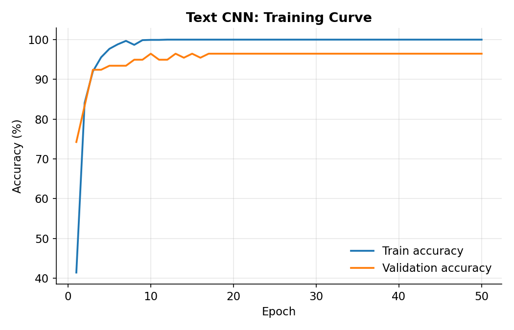
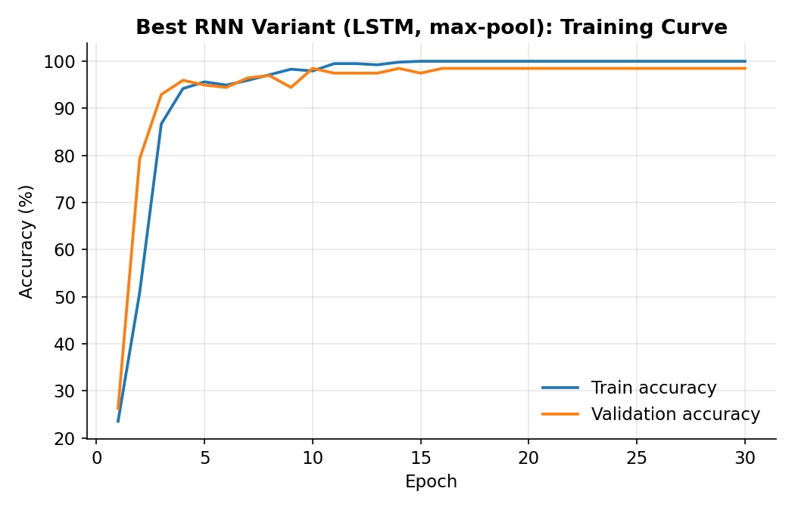
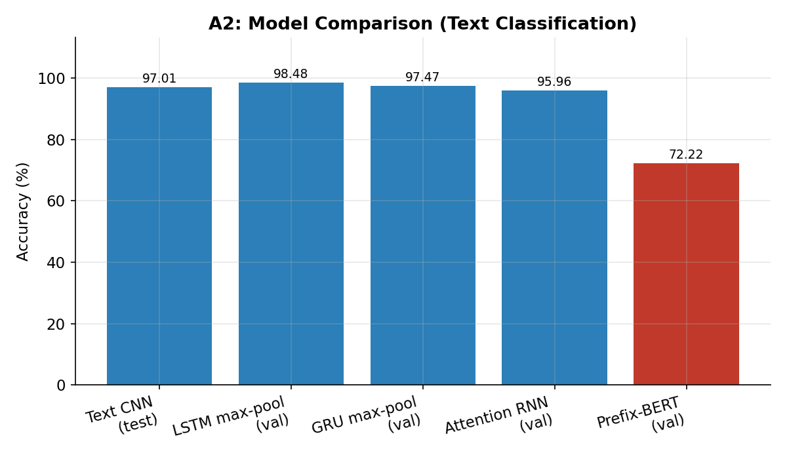

# Text Classification & Sequence Models

A progression of text classifiers on the same small dataset: a word-embedding baseline, a Text CNN, 13 RNN/LSTM/GRU/attention variants, and a prefix-tuned BERT model — ending with a final head-to-head comparison of the strongest models.

## Dataset

A labelled text classification dataset with a 198-example validation split, used consistently across all three notebooks.

## Approach

**`01_word_embeddings_textcnn.ipynb`** builds a GloVe-embedding + logistic-regression baseline, then a Text CNN (three parallel Conv1d filters, kernel sizes 3/5/7, global max-pooling).

**`02_rnn_lstm_gru_attention.ipynb`** benchmarks 13 sequence-model variants: SimpleRNN/LSTM/GRU × {mean, max, last-state} pooling, GRU with pretrained GloVe embeddings (frozen, fine-tuned, and scratch-initialised), and a GRU + attention model.

**`03_prefix_bert_vs_textcnn.ipynb`** prefix-tunes a pretrained `bert-base-uncased` model, then runs a final best-checkpoint comparison between the Text CNN and the best RNN model (LSTM, max-pool) on the held-out test set.

## Results

| Model | Accuracy | Source |
|---|---|---|
| GloVe + logistic regression (baseline) | 90.40% val | `01_word_embeddings_textcnn.ipynb` |
| Text CNN | **97.01% test** | same notebook |
| LSTM, max-pool (best RNN) | **98.48% val** | `02_rnn_lstm_gru_attention.ipynb` |
| GRU, max-pool | 97.47% val | same notebook |
| Attention RNN (GRU + attention) | 95.96% val | same notebook |
| SimpleRNN, last-state pooling (failed run) | 27.27% val | same notebook |
| Prefix-tuned BERT | 72.22% val | `03_prefix_bert_vs_textcnn.ipynb` |
| **Final selected model: Text CNN** | **97.01% test** (val 0.9848 vs. LSTM-max's 0.9747) | same notebook |

Full per-run table (all 13 RNN variants) and cell-level citations are in [`../../docs/RESULTS.md`](../../docs/RESULTS.md).

## Key findings

- **Pooling strategy mattered more than cell type.** Across SimpleRNN/LSTM/GRU, switching to last-state pooling was far more damaging than switching the recurrent cell: one SimpleRNN + last-state configuration never learned at all (27.27% validation accuracy, barely above the task's ~16.7% chance level), while the same cell type with max-pooling reached 96.46%.
- **A small, purpose-built model beat a much larger pretrained one.** The compact Text CNN (97.01% test accuracy) comfortably outperformed prefix-tuned BERT (72.22% validation accuracy) on this dataset, and was selected as the final best model over LSTM-max (which tied on test accuracy but had lower validation accuracy).
- Fine-tuning pretrained GloVe embeddings inside a GRU (97.47% val) clearly beat freezing them (93.43% val best), showing the embeddings needed task-specific adaptation.

## Limitations

- **The validation set has only 198 examples.** Differences of a few points between variants (e.g. 95.45% vs. 97.47%) are within the noise of a split this small and shouldn't be read as a reliable ranking.
- **One RNN configuration failed to train:** SimpleRNN with last-state pooling never exceeded ~27% validation accuracy and was not tuned further (no learning-rate or initialisation sweep was attempted for it specifically). LSTM with last-state pooling (69.19% val) also clearly underperformed every other LSTM/GRU variant, though it did learn.
- All results are from single training runs with a single seed.

## What I'd do next

- Run the full RNN comparison with multiple seeds, given how small the validation set is.
- Diagnose why last-state pooling fails for SimpleRNN specifically (likely vanishing gradients over the sequence length without max-pooling's shortcut).
- Try a larger or more diverse dataset where prefix-tuned BERT's pretraining might have more room to pay off.

## Environment

Python, PyTorch 2.11, Hugging Face `transformers`, trained on Apple MPS (Apple Silicon GPU).

---
*Built as part of Monash University FIT5215 Deep Learning (2026).*
